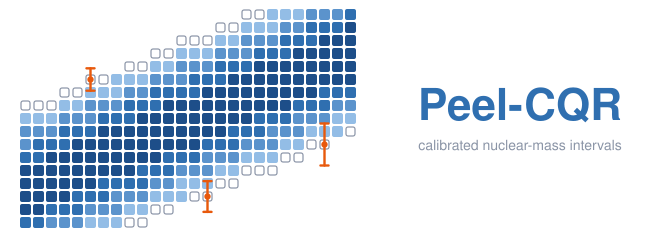

<p align="center">
  
</p>

# Peel-CQR: Calibrated Prediction Intervals for Nuclear Masses under Extrapolation

Code for **Peel-CQR**, a conformal method that gives prediction intervals for nuclear binding energies whose coverage holds on nuclei measured *after* the training data.

## The problem

About 2,500 nuclear masses have been measured, but several thousand more nuclei are expected to exist, and their masses drive models of stellar nucleosynthesis. Machine-learning corrections to physics mass models now predict known masses to a few hundred keV, but a prediction for an unmeasured nucleus is only useful with an honest uncertainty.

New masses are always measured **at the edge of the known nuclear chart**. Every prediction for an unmeasured nucleus is therefore an extrapolation. Intervals calibrated on a random hold-out measure *interpolation* error, so they are too narrow exactly where they are needed.

## The idea

Peel-CQR manufactures the extrapolation from the data we already have:

1. **Peel.** Remove the outer `K` layers of the measured chart. What remains is the *core*.
2. **Fit.** Train a quantile model (5%, 50%, 95%) on the core only.
3. **Calibrate per distance.** The peeled nuclei now sit at known distances `d = 1, …, K` from the core, just as future measurements will sit at distance `d` from today's chart. Their conformal scores give a separate calibration constant `c_d` for each distance.
4. **Predict.** Refit the quantile model on all measured nuclei. A new nucleus at distance `d` gets the interval `[q_low − c_d, q_high + c_d]`; beyond `K` the constant is extended linearly.

No later mass evaluation is needed for calibration, and under a per-distance exchangeability assumption the intervals inherit the finite-sample coverage guarantee of split conformal prediction.

### What the logo shows

The logo is a stylised chart of nuclides (protons up, neutrons across). The dark core is the region the model is trained on; the three lighter rings are the peeled frontier layers used for calibration; the outlined cells are unmeasured nuclei. The orange bars are prediction intervals, which grow wider the farther a nucleus lies from the measured region — the behaviour Peel-CQR is designed to capture.

## Evaluation design

The benchmark uses four Atomic Mass Evaluations (AME2003, 2012, 2016, 2020) as a time series. Each fold trains on one edition and tests on the nuclei **first measured in a later edition**, so test nuclei are genuine future measurements. Coverage is reported with Clopper–Pearson intervals, tested against the nominal level with exact binomial tests, and methods are compared pairwise with exact McNemar tests.

Methods compared: Gaussian-process credible intervals, CQR with random calibration, CQR calibrated on the next edition (with and without distance scaling), and Peel-CQR.

## Repository layout

```
assets/logo.svg                      logo
notebooks/
  nuclear_mass_conformal_v2.ipynb    main experiment: rolling folds, Peel-CQR, statistical tests, Excel export
  nuclear_mass_conformal_v1.ipynb    first single-fold version
requirements.txt
```

Running the v2 notebook produces `nuclear_mass_results_v2.xlsx` (all result tables: pooled, per fold, by distance, McNemar tests, robustness, sensitivity to K) and `predicted_masses_intervals_v2.csv` (median and 90% interval for every nucleus estimated in AME2020).

## Running

```bash
pip install -r requirements.txt
jupyter notebook notebooks/nuclear_mass_conformal_v2.ipynb
```

The notebook downloads the AME tables from the IAEA Atomic Mass Data Center. Some servers refuse scripted downloads (HTTP 403); in that case download `mass.mas03`, `mass.mas12`, `mass16.txt` and `mass_1.mas20.txt` from <https://www-nds.iaea.org/amdc/> and place them in `ame_data/`. On Kaggle, upload them as a dataset and the notebook finds them automatically. Runtime is about 5–10 minutes on a CPU.

**Changing the base model.** Load a WS4, FRDM2012 or HFB table with `load_base_table(...)` (Section 3 of the notebook).

**Changing the learner.** Replace `QuantileGB` with any class that has `fit(X, y)` and `predict3(X) -> (low, median, high)`, for example a neural quantile network.

## Data

Atomic Mass Evaluations AME2003 (Nucl. Phys. A 729, 337), AME2012 (Chin. Phys. C 36, 1603), AME2016 (Chin. Phys. C 41, 030003) and AME2020 (Chin. Phys. C 45, 030002–030003). The AME files are not redistributed here.

## Citation

A manuscript describing the method is in preparation. Please contact the author before citing.

## Author

Mohamad Yamen AL-Mohamad — Department of Statistics, University of Tabriz.

## License

MIT. See `LICENSE`.
